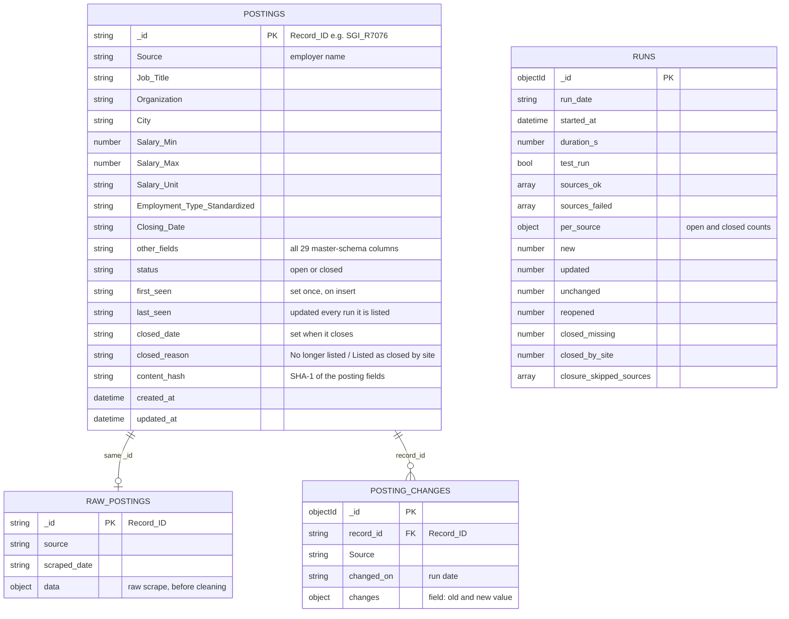
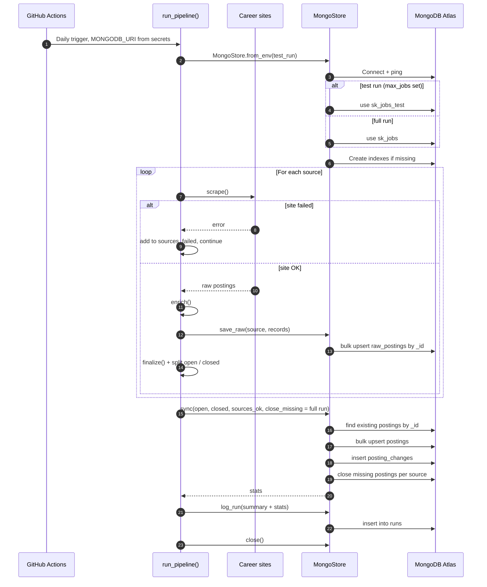
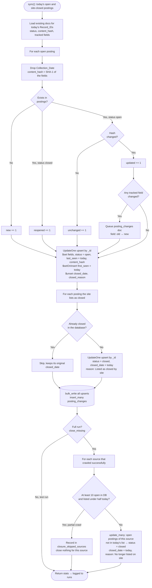
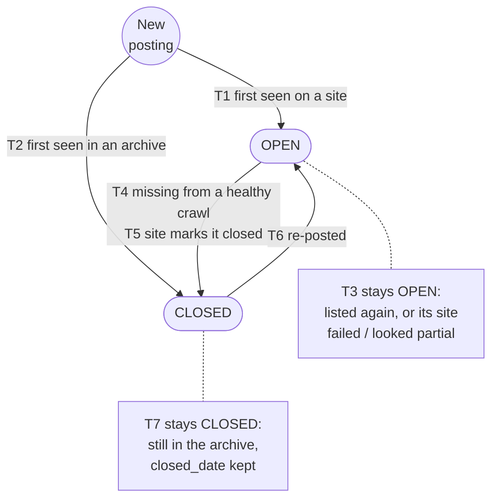

# MongoDB Logic: Saskatchewan Public-Sector Job Pipeline

These diagrams show how each daily run stores job postings in MongoDB Atlas (`mongo_store.py`). GitHub renders the Mermaid diagrams automatically.

1. [Data model](#1-data-model): the four collections and how they link
2. [One run, step by step](#2-one-run-step-by-step): what the pipeline sends to MongoDB and when
3. [Upsert and closure logic](#3-upsert-and-closure-logic): how `sync()` decides what happens to each posting
4. [Posting lifecycle](#4-posting-lifecycle): the states a posting moves through

MongoDB is switched on by the `MONGODB_URI` environment variable, which is a GitHub Actions secret in the scheduled runs. Full runs write to the **`sk_jobs`** database. Test runs (`--max-jobs`) write to **`sk_jobs_test`**, so they never touch the real data.

---

## 1. Data model

`Record_ID` (`<SOURCE>_<Job_ID>`, e.g. `SGI_R7076`) is the key that links everything. It's stable from run to run, so a posting is updated in place rather than duplicated.

| Collection | One document per | Purpose | Indexes |
|---|---|---|---|
| `postings` | posting | The clean, current state of every posting ever seen, open or closed | `status + Source`, `first_seen`, `last_seen` |
| `raw_postings` | posting | The latest raw scrape, so cleaning can be re-run without re-scraping | `_id` |
| `posting_changes` | change | Salary, title, closing-date, location, openings and employment-type edits on open postings | `record_id + changed_on` |
| `runs` | pipeline run | Run summary for monitoring: counts, failed sites, duration | `started_at` |

---

## 2. One run, step by step

---

## 3. Upsert and closure logic

**Why the run is safe to repeat (idempotent):** every write is an upsert keyed on `Record_ID`. Running twice on the same day gives the same database: `first_seen` is only set on insert, an unchanged posting keeps its hash, so no duplicate change records are logged, and closures already recorded keep their date.

---

## 4. Posting lifecycle

| | Transition | What triggers it | What gets written |
|---|---|---|---|
| T1 | New → Open | A posting appears on a site for the first time | `first_seen = last_seen = today`, `status = open` |
| T2 | New → Closed | First seen in a site's archive (SaskWater's past PDFs) | `status = closed`, reason "Listed as closed by site" |
| T3 | Open → Open | Listed again; or its site failed or looked like a partial crawl | `last_seen = today` when listed; field edits logged to `posting_changes` |
| T4 | Open → Closed | Missing from a full, healthy crawl of its site | `closed_date = today`, reason "No longer listed on site" |
| T5 | Open → Closed | The site itself marks it closed | `closed_date = today`, reason "Listed as closed by site" |
| T6 | Closed → Open | The same posting is listed again (re-posted) | `status = open`, `closed_date` and `closed_reason` removed, counted as `reopened` |
| T7 | Closed → Closed | Still in the site's archive | Nothing, so the original `closed_date` is kept |

**For analysis:** `last_seen − first_seen` is how long a posting stayed up. Closed postings (`status = closed`) are the training set for the AI/ML models, and `posting_changes` shows how salaries and deadlines move while a posting is open.
