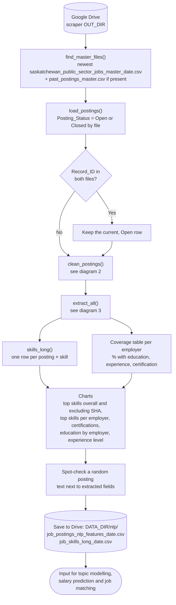
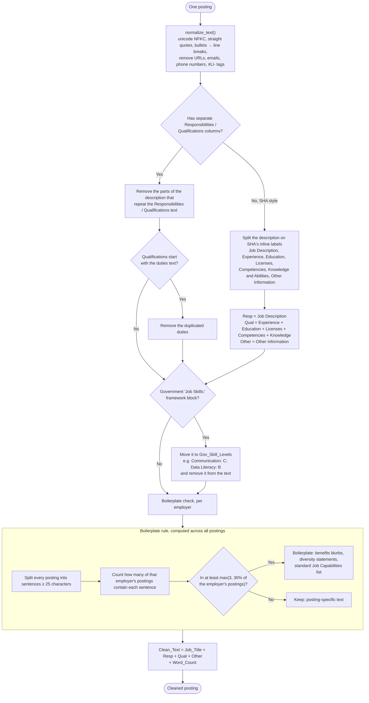
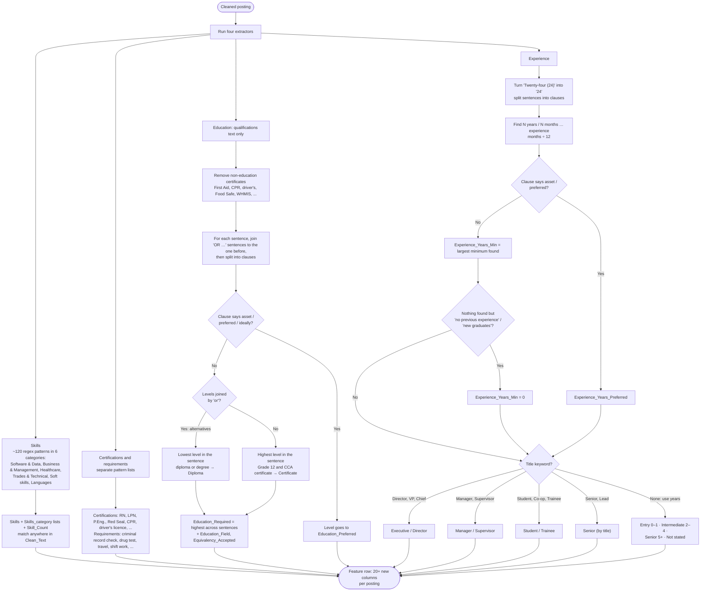
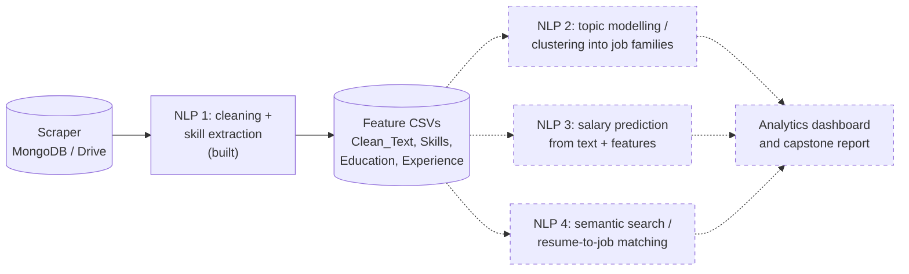

# NLP Logic: Text Cleaning and Skill Extraction

These diagrams show how the NLP notebook (`job_postings_nlp_1_skills.ipynb`) turns the free text of each posting into structured features for analysis and modelling. GitHub renders the Mermaid diagrams automatically.

1. [Notebook pipeline](#1-notebook-pipeline): from the scraper's files on Google Drive to the feature CSVs
2. [Text cleaning](#2-text-cleaning): sections, boilerplate and the Government skills framework
3. [Feature extraction](#3-feature-extraction): skills, certifications, education and experience
4. [Where this leads](#4-where-this-leads): the NLP stages planned next

Extraction is **rule-based**: a skill taxonomy plus regex patterns. Every result can be traced back to the text that produced it, and no labelled training data is needed.

---

## 1. Notebook pipeline

---

## 2. Text cleaning

---

## 3. Feature extraction

---

## 4. Where this leads

The features from this notebook are the input for the next NLP stages. Dashed boxes are planned, not built yet.

