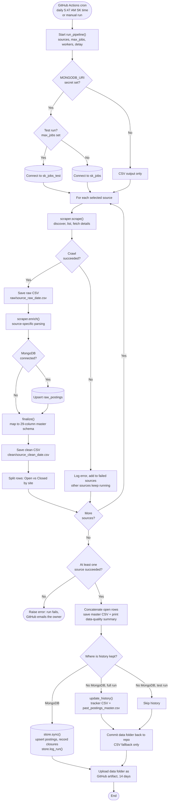
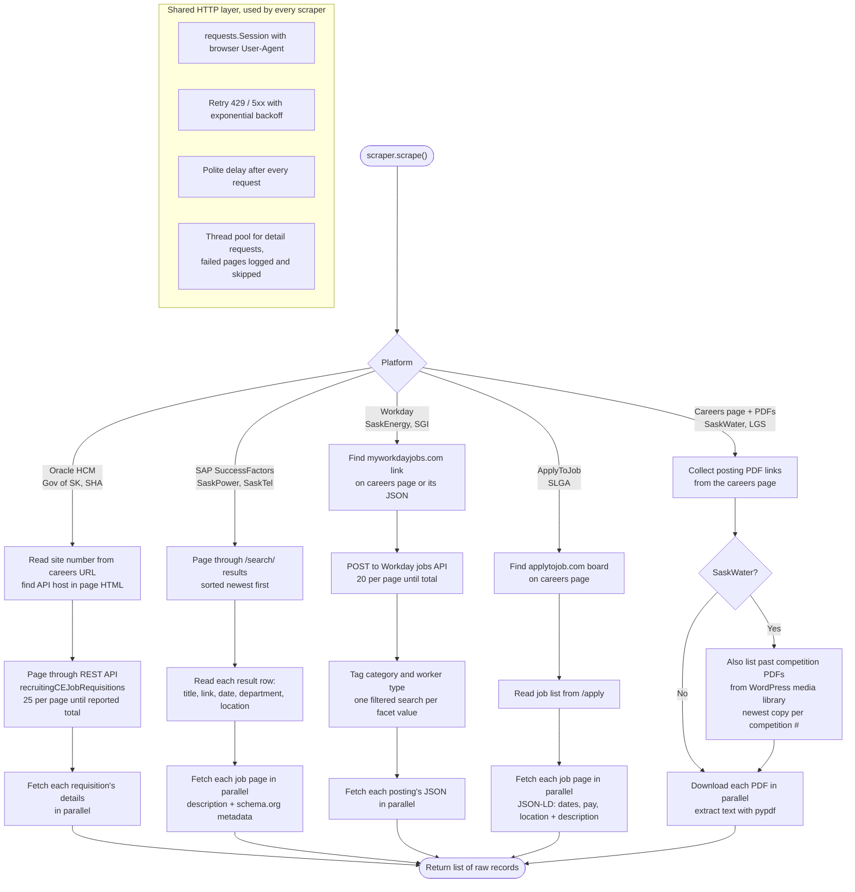
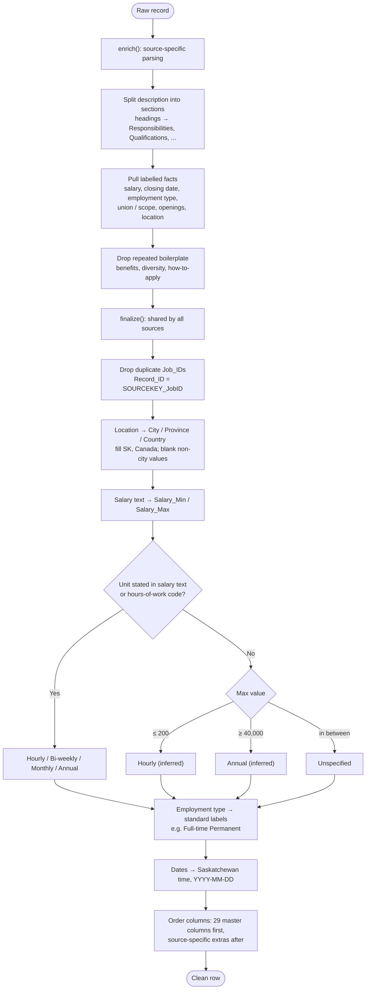
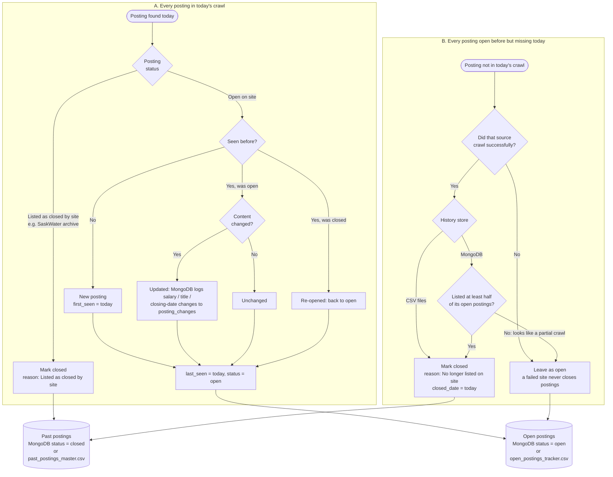

# Scraper Logic: Saskatchewan Public-Sector Job Pipeline

These flowcharts show how `sk_jobs_scraper.py` collects job postings from nine public-sector career sites and turns them into one dataset. GitHub renders the Mermaid diagrams automatically.

1. [End-to-end pipeline](#1-end-to-end-pipeline): one daily run, from trigger to storage
2. [Per-source scraping](#2-per-source-scraping): how each platform is crawled
3. [Cleaning and standardization](#3-cleaning-and-standardization): how a raw posting becomes a master-schema row
4. [History and closure tracking](#4-history-and-closure-tracking): how closed postings are detected and kept

---

## 1. End-to-end pipeline

---

## 2. Per-source scraping

Every scraper exposes the same interface: `scrape()` returns raw records and `enrich()` parses them, so the pipeline doesn't depend on any one platform. Only each employer's public careers page is configured. Every other URL is discovered at run time.

---

## 3. Cleaning and standardization

---

## 4. History and closure tracking

A job board only shows what's open today. To keep closed postings for analysis and model training, each run compares today's postings with what was open before.

